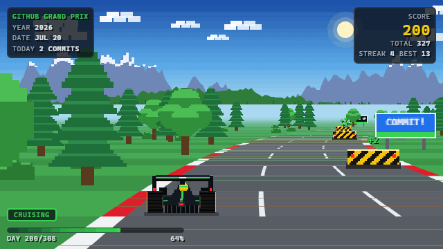

<div align="center">

# 🏁 GITHUB F1 GRAND PRIX

**My GitHub contribution calendar, raced as an autonomous pseudo-3D Formula 1 arcade game.**

<a href="https://roshanimmanuel792.github.io/github-f1-grand-prix/">
  
</a>

### [▶ PLAY GITHUB GRAND PRIX](https://roshanimmanuel792.github.io/github-f1-grand-prix/)

</div>

## 🏆 This season

<!-- STATS:START -->
| Season | Final score | Race days | Active days | Zero days | Longest streak | Current streak | Best day |
| :-: | :-: | :-: | :-: | :-: | :-: | :-: | :-: |
| **2026** | **336** | 315 | 91 | 224 | 13 days | 0 days | 32 (2026-05-09) |

<sub>Contributions from 2026-01-01 to 2026-11-11 · source: GitHub GraphQL API · refreshed daily by GitHub Actions</sub>
<!-- STATS:END -->

The final score is always the exact sum of the season's daily contributions — no bonuses, no multipliers.

## 🎮 How the race works

- **Every calendar day is one stretch of track**, from January 1 to the latest day GitHub has data for (never future dates). Zero-contribution days are still raced; they're just clear track.
- **Each day's contribution count becomes an obstacle** on that day's stretch:

  | Daily contributions | Obstacle | Difficulty |
  | :-: | --- | --- |
  | 0 | Clear track | Clear |
  | 1–2 | Road block | Easy |
  | 3–4 | Traffic cones / tyre stack | Medium |
  | 5–9 | Tyre barrier (two lanes) | Hard |
  | 10+ | Racing barrier across the road with one gap (green arrow) | Extreme |

- **The car drives itself.** An autonomous driver plans a collision-free route over three logical lanes and steers smoothly into each gap before reaching it, then drifts back to the centre racing line.
- **Score only increases when a day's stretch is completed**, by exactly that day's count. GAME OVER appears only after the last available day is finished.
- **Nitro** (visual only) kicks in on 10+, 20+ and 30+ contribution days.

**Controls:** `Space`/`P` pause · `R` restart · `M` sound on/off · `Enter` start. Sound is off until you turn it on.

**URL options:** `?year=2025` (past season) · `?duration=120` (race length, seconds) · `?autoplay=0` · `?demo=1` (synthetic data, clearly labelled **DEMO DATA**) · `?debug=1` (FPS + AI decision log in the console).

## 🛠️ Tech stack

Vanilla JavaScript ES modules · HTML5 Canvas 2D · Vite · Vitest · Playwright · Node.js · GitHub GraphQL API · GitHub Actions · GitHub Pages.
Zero runtime dependencies. All graphics are original procedural pixel art and all sounds are synthesised with the Web Audio API.

## 🚀 Setup (for your own profile)

### 1. Set your username

Edit **`game.config.json`**. It's the only place the username lives:

```json
{ "githubUsername": "your-github-username" }
```

### 2. Create the `GH_TOKEN` secret (recommended)

1. Go to **GitHub → Settings → Developer settings → Personal access tokens → Tokens (classic) → Generate new token (classic)**.
2. Name it e.g. `f1-grand-prix`, pick an expiry, and tick only **`read:user`**. No repository scopes are needed.
3. Copy the token, then open **your repository → Settings → Secrets and variables → Actions → New repository secret**.
4. Name: **`GH_TOKEN`**, Secret: paste the token → **Add secret**.

The token is only used by the `Update contributions` workflow, server-side. It is never sent to the browser, printed, or written to any file.
If the secret is missing, the workflow falls back to GitHub's **public contribution calendar**, which needs no token at all.

**Private contributions:** to have private-repository contributions counted (as anonymous counts, the same way your profile shows them), enable **Profile → Contribution settings → "Private contributions"**. This works with a `read:user` token and with the public fallback. Granting the token the broad `repo` scope also works, but isn't recommended.

### 3. Enable GitHub Pages

1. **Repository → Settings → Pages → Build and deployment → Source: GitHub Actions**.
2. **Repository → Settings → Actions → General → Workflow permissions: Read and write permissions** → Save (lets the data workflow commit refreshed JSON with the built-in `GITHUB_TOKEN`).
3. **Actions → Update contributions → Run workflow** once. When it finishes, **Deploy to GitHub Pages** runs automatically.
4. The game is live at `https://<username>.github.io/<repository>/`. The build uses relative paths, so any repository name works.

### Automation

| Workflow | Trigger | What it does |
| --- | --- | --- |
| `update-contributions.yml` | Daily 01:17 UTC + manual (optional `year` input) | Fetches the season, validates it, refreshes the README stats, and commits **only if the data changed**. On any API failure nothing is written, so the last valid dataset stays live. During Jan 1–7 it also refreshes last season to capture Dec 31. |
| `deploy.yml` | Push to `main`, after a successful data update, manual | Unit tests, data validation, Playwright browser tests, production build, Pages deploy. |

Commits made with `GITHUB_TOKEN` don't trigger workflows, so there's no loop; the deploy follows data updates via `workflow_run`.

## 💻 Local development

```bash
npm install
npm run dev              # http://localhost:5173
npm test                 # unit tests (Vitest)
npx playwright install chromium && npm run test:e2e   # browser tests
npm run build            # production build to dist/
npm run fetch            # refresh data (public calendar; or GH_TOKEN via: node --env-file=.env scripts/fetch-contributions.js)
npm run validate         # validate all data files
npm run preview:gif      # re-record docs/preview.gif from the real renderer
```

## 🧱 Architecture

```
game.config.json            single source of configuration (username, pacing, thresholds)
scripts/
  fetch-contributions.js    GraphQL (GH_TOKEN) or public-calendar fetch → normalized, validated JSON
  validate-contributions.js validates every season file + index
  update-readme.js          rewrites the README stats block
  generate-preview.js       records docs/preview.gif via Playwright + gifenc
public/data/contributions/  <year>.json + index.json (generated, committed)
src/
  data/dataset.js           date math, normalization, validation, stats (shared by browser + Node)
  data/loader.js            loads generated JSON in the browser (never calls the GitHub API)
  game/track.js             procedural circuit: smooth curves, hills, scenery (typed arrays)
  game/obstacles.js         contribution thresholds → obstacle rows with a guaranteed safe lane
  game/planner.js           Viterbi lane planner + nearest-free-lane fallback
  game/driver.js            autonomous driver: detection range, timed smooth manoeuvres, safety override
  game/race.js              deterministic fixed-step simulation, lifecycle, scoring, collisions
  render/sprites.js         original procedural pixel art (car, obstacles, scenery)
  render/renderer.js        OutRun-style pseudo-3D projection, parallax, fog, nitro effects
  ui/ui.js                  HUD + screens (DOM touched only when values change)
  audio/audio.js            synthesised engine / road / nitro / finish sounds
  main.js                   boot, requestAnimationFrame loop, controls
tests/                      Vitest unit tests + Playwright e2e (tests/e2e)
```

**Why the car never crashes:** obstacle rows are generated around a "safe lane" that moves at most one lane per day, so a valid route always exists. The planner finds the minimum-steering route over the whole season (preferring the centre line), and the driver times each lane change to finish before the obstacle using the cruise speed as an upper bound. A safety controller overrides any plan that would enter a blocked lane. The tests plan routes for 25 randomized seasons and race full seasons end to end (including the fastest allowed pace and back-to-back extreme barriers), asserting zero collisions and an exact final score.

**Determinism and performance:** the simulation advances in fixed 1/120 s steps, independent of refresh rate. Rendering happens at a fixed low internal resolution (pixel-art look, cheap on any device pixel ratio), scaled up with CSS. The render loop allocates nothing per segment.

### Configuration reference (`game.config.json`)

| Key | Default | Meaning |
| --- | --- | --- |
| `githubUsername` | — | Whose contributions to race |
| `raceMode` | `"yearly"` | The only supported mode: the yearly Grand Prix |
| `selectedYear` | `"auto"` | `"auto"` = latest season with data, or a year like `2025` |
| `autoPlay` / `autoPlayDelaySeconds` | `true` / `4` | Start automatically after the ready screen (off when the visitor prefers reduced motion) |
| `showControls` | `true` | Show pause / restart / sound buttons |
| `targetFPS` | `60` | Render frame cap |
| `raceDurationSeconds` | `180` | Target race length |
| `minSecondsPerDay` | `0.25` | Fastest pace per day (keeps lane changes smooth) |
| `aiLookaheadDays` | `1.5` | AI detection distance, in days of track (≥ 1.1) |
| `obstacleThresholds` | `1 / 3 / 5 / 10` | Contribution counts for easy / medium / hard / extreme obstacles |
| `nitroThresholds` | `[10, 20, 30]` | Visual nitro levels |

## ⚠️ Known limitations

- GitHub's calendar uses your profile's timezone; the newest day may lag or lead UTC by a few hours until the next daily run.
- `includePrivateContributions` isn't a config switch: the daily calendar can't split private from public counts per day, so private counts follow your profile's "Private contributions" setting.
- GitHub disables scheduled workflows in repositories with no activity for 60 days. The daily data commits normally keep it active; if it gets paused, re-enable it from the Actions tab.
- `docs/preview.gif` is recorded locally (`npm run preview:gif`) rather than in CI, so it shows the season at recording time. The stats table above stays current.

## 🙏 Credits

Built by [@roshanimmanuel792](https://github.com/roshanimmanuel792). Inspired by classic pseudo-3D arcade racers such as OutRun and by Jake Gordon's write-ups on pseudo-3D road rendering.
All car, obstacle and scenery art and all audio are original to this project. No real team liveries, logos or trademarks are used. Contribution data comes from GitHub.
